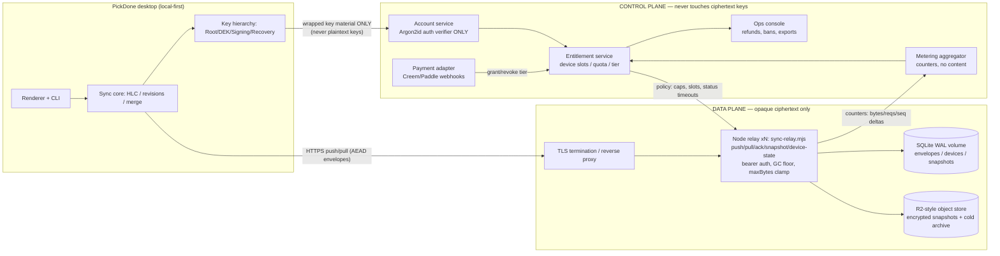

# Sync v2 Cloud — Control Plane vs Data Plane Architecture

Companion: `docs/sync-v2-cloud-capacity-economics.md` (cost model + NO-GO gates).
Sources of truth read before writing this: `pickdone/server/sync-relay.mjs`,
`pickdone/server/sync-relay-sqlite.mjs`, `docs/sync-v2-infra-design.md`,
`docs/sync-v2-core-design.md`, `docs/cloud-sync-evaluation-brief.md` (§6 adopted
review: relay = protocol-aware/business-blind, GC state machine, device slots,
server-enforced entitlements, PII minimization).

## 1. Architecture (Mermaid)

Boundary rule: the data plane executes policy handed to it by the control plane
(caps, device status timeouts) but can NEVER see plaintext. The control plane
sees identity, metering and money — never content, never DEKs.

## 2. Multi-tenant isolation

- Tenant = `account`. Today the relay accepts a client-asserted `account`
  string (register + optional enrollment secret soften takeover). Migration
  (BLOCKED on control plane): account = server-issued identity; relay maps
  opaque `accountId` -> per-tenant SQLite namespace or row-level partition.
- Row isolation: every table already keys on `account` (envelopes/devices/
  snapshots) — no cross-tenant query exists in the code paths; keep it that way
  and add a CI check that any new data-plane SQL carries an `account = ?` term.
- Device isolation: per-device bearer secret, timing-safe compare; account-level
  routes (snapshot) accept any active device secret of that account only.
- Process isolation at scale: one SQLite volume per relay shard; accounts are
  hashed onto shards by the control plane (enables per-shard backup/restore).

## 3. Quota metering & enforcement (server-side, per adopted review §6-5)

- Counters live in the control plane; the data plane reports: pushed bytes,
  pulled bytes, request counts, device count, snapshot generations stored.
  Counters are additive integers keyed (account, day, metric) — NO content.
- Enforcement points that MUST stay in the data plane for latency reasons:
  maxBytes clamp (exists: 4 MiB default / 32 MiB hard), body cap (8 MiB),
  register rate limit (10/min/IP) — plus NEW: envelope rate per device,
  device-slot check at register, storage cap checked against metering rollup.
- Free tier: 1 device slot, no version history (1 snapshot generation), no cold
  archive; paid: slots/quota per pricing config. Exceeding quota = push 403 with
  a coded error + client-visible upgrade hint, never silent drop.

## 4. Retention / deletion semantics

- Hot envelope GC: floor = min(durable ack among ACTIVE devices, snapshot
  coversSeq); ack-alone floor keeps `GC_ACK_ALONE_MARGIN` replay window. This is
  DELETION AS DELIVERY: a deleted envelope is fully replicated or snapshotted.
- Cold archive deletion: after `retentionMonths + coldArchiveMonths`, segments
  are deleted by a scheduled job with a tombstone ledger entry (account, seq
  range, hash) so deletion itself is auditable.
- Account deletion (regulatory): control plane issues a purge order; data plane
  drops the account namespace (SQLite rows + object prefixes), control plane
  retains only payment/tax records legally required; client keeps local data
  (local-first promise unaffected).
- Device retired -> its ack no longer counts toward the floor after the STALE
  window (lifecycle policy from control plane; the relay currently knows only
  `active`/`retired` — the STALE timeout policy is a control-plane handoff).

## 5. E2EE — server never holds plaintext keys

- Key hierarchy per `docs/sync-v2-infra-design.md` §7: password -> Argon2id auth
  material (verification ONLY, never decrypts); Account Root Key generated
  client-side, wrapped by Recovery Key (24 words); DEK wraps revisions/
  snapshots/blobs; Ed25519 signing key signs anti-rollback checkpoints.
- Server stores: auth verifier, WRAPPED root key, public keys, ciphertext.
  Envelope/snapshot bytes are AEAD ciphertext — the relay's storage contract
  (opaque string) is already correct for this; what is missing today is the
  client-side crypto (Step 7) and the codec version marker.
- Password reset restores login only; data needs Recovery Key or a trusted
  device (binding UX copy from spec §38).

## 6. Metadata minimization & audit/privacy

- Stored today per envelope: account, serverSeq, opId, envelopeJson — already
  minimal. KEEP OUT: IPs at rest, payload field counts, entity-type tags.
- Logs: request logs keep (shard, route, status, byte count, truncated
  account hash, timestamp) — no IP, no user agent beyond coarse family for
  crash triage, TTL <= 30 days hot / 180 days cold, PII-minimized from day one
  (adopted review §6-7: E2EE does not exempt logs/IP/payment records under
  PIPL; they are personal information).
- Audit trail (append-only, control plane): tier changes, device register/
  revoke, purge orders, refund actions. Data plane emits delivery counters;
  neither contains content or keys.
- China deployment: region-pinned storage, ICP/telecom qualification decided
  BEFORE M3 open beta (carried from evaluation brief).

## 7. Refunds & entitlement degradation

- Refund (payment webhook) -> entitlement service marks tier=free at period end
  (or immediately for abuse cases): data plane sees `entitlement.changed` and
  applies DEGRADATION, not deletion: slots clamp to free cap (newest registered
  win; user picks which devices stay), snapshot generations collapse to 1,
  cold archive gets a grace window (>= 90 days) then per §4 deletion semantics.
- Local data is NEVER touched (local-first); degradation only limits the cloud
  relay path. Paid re-upgrade restores slots/history immediately (metering
  history retained in control plane).
- Chargeback/fraud: freeze pushes (403 coded), keep pulls for 30 days, then
  standard deletion path with email notice.

## 8. Billing & cost alarms

- Metering rollup daily; alarm thresholds wired to the cost model inputs:
  - per-account drift: pushed bytes/user-day > 5x neutral scenario
    (`changesPerDeviceActiveDay` x payload) -> abuse review queue
  - fleet drift: monthly variable cost per user exceeds 2x the model's
    `perUser.paid.cost.pureVariable` -> page ops
  - egress: quota overrun (`quotaOverrunPct > 0`) -> scale-out runbook
  - storage: cold archive growth > model projection band -> retention audit
  - availability: relay error rate > 1% / pull p95 > 2 s -> page ops
- Alarm payloads carry metric values only (no content), routed to the ops
  console with an audit entry.

## 9. Blocked on control-plane integration (do NOT migrate ahead of the mainline)

Current relay facts (sync-relay.mjs / sync-relay-sqlite.mjs) that MUST wait for
the mainline control plane before changing:

| # | Current state | Required change | Why blocked |
|---|---|---|---|
| 1 | `account` is a client-asserted string; register is open with optional enrollment secret | server-issued accountId + identity service | account model is an M2 control-plane deliverable; migrating alone forks identity |
| 2 | `devices.deviceSecret` stored as plaintext hex | hash-at-rest (per-device secret) + rotation | schema migration + dual-write window must be coordinated with the billing agent's account tables |
| 3 | `snapshots` = ONE row per account (latest generation only) | multi-generation retention (+ R2 object track) for paid version history | storage-class decision + metering rollup are control-plane scope |
| 4 | `envelopeJson` is an unversioned plaintext string | codec/envelope version marker (AEAD ciphertext self-describing) | E2E Step 7 owns the frame format; relay schema must not drift ahead |
| 5 | device status whitelist = `active`/`retired` only | STALE timeout + DETACHED lifecycle policy execution | policy thresholds are an entitlement-service deliverable |
| 6 | no quota/entitlement fields anywhere | metering event stream + enforcement hooks | belongs to the billing agent's ledger seam; do not pre-build tables |
| 7 | `server.maxConnections = 64` single process | shard/dispatch layer for scale-out | capacity targets must come from the cost model runbook, owned by ops |

Rule: data-plane work before the control plane lands is limited to (a) keeping
the opaque-string storage contract, (b) the capacity model + tests in
`tools/cost-model/`, (c) hardening that does not change schema or protocol.
